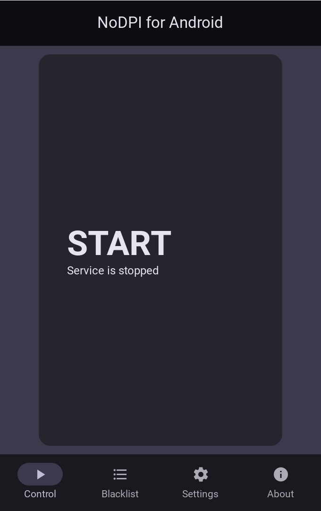

<div align="center">
  <p>
    <a href="#"></a>
  </p>
</div>

# NoDPI
<b><i>Say NO to blocking!</b></i>

[](https://github.com/GVCoder09/NoDPI4Android)
[](https://www.gnu.org/licenses/gpl-3.0.txt)
[](https://github.com/GVCoder09/NoDPI4Android)
[](https://github.com/GVCoder09/NoDPI4Android)
[](https://github.com/GVCoder09/NoDPI4Android)
[](https://github.com/GVCoder09/NoDPI4Android)
[](https://github.com/GVCoder09/NoDPI4Android)
[](https://github.com/GVCoder09/NoDPI4Android)

> [!IMPORTANT]
> This project is a fork of the repository https://github.com/theo0x0/nodpi and is developed independently. Do not confuse with https://github.com/raspabamos/nodpi !

> [!NOTE]
> This version is only for Android. **The Desktop version is available here:** https://github.com/GVCoder09/NoDPI

**Read this in other languages / Читайте на других языках**
- **[English](README.md)**
- [Русский](README.ru.md)

## Table of Content

- [NoDPI](#nodpi)
  - [Table of Content](#table-of-content)
  - [Description](#description)
    - [How does this work](#how-does-this-work)
    - [Sites currently unavailable via NoDPI](#sites-currently-unavailable-via-nodpi)
    - [Alternatives](#alternatives)
      - [Android](#android)
      - [Other platforms](#other-platforms)
  - [System requirements](#system-requirements)
  - [Terms of Use and Disclaimer](#terms-of-use-and-disclaimer)
  - [Quick start](#quick-start)
    - [Additional Blacklists](#additional-blacklists)
  - [Building APK from source code](#building-apk-from-source-code)
  - [FAQ](#faq)
  - [Star History](#star-history)

## Description
  NoDPI4Android is a graphical add-on [NoDPI](https://github.com/GVCoder09/NoDPI). This application is designed to run on Android devices only, Windows and Linux version available [here](https://github.com/GVCoder09/NoDPI/releases)

  NoDPI is a utility designed to bypass DPI (Deep Packet Inspection). What is DPI? DPI is a technology for inspecting network packets based on their content to regulate and filter traffic. It is often used by internet service providers to censor and block access to certain web resources and protocols. The goal of this program is to "trick" DPI by modifying network packets, although in reality, this trickery is often simply a consequence of a lack of computing resources and time. 
 
  This utility was developed primarily for Russian users as a simpler (but less powerful) replacement for similar tools. In most cases, it gets the job done; in particular, it allows you to use YouTube without any problems.

  But unfortunately, the absolute performance of this utility cannot be guaranteed. Some sites, such as YouTube, are good to unlock, while others, as Instagram.com or Facebook.com, require completely different methods for bypassing locks, which are not yet implemented in this utility from their low-leveling and difficulty. Sometimes, the performance of certain sites can also depend on the provider - how it blocks the site and what technical means applies.

<div align="center">
  <p>
    
  </p>
</div>

### How does this work

NoDPI launches a proxy server on your computer through which you direct http(s) traffic. The program intercepts ClientHello of outing connections and fragments them according to one of the following methods:

*Fragmentation by SNI  (by default)*

The packet contains a field containing the SNI record. The ClientHello is split into several TLS records: the pre-SNI portion, the SNI character-by-character, and the post-SNI portion. Each portion is appended with a header indicating the ClientHello type, and then the entire packet is sent in a single packet.

*Random fragmentation*

Clienthello is divided into several parts of random length. Each part is glued with the prefixes of the type of Clienthello and then all this is sent in one package.

Also regardless of the method, the TLS version is replaced by version 1.3, which is the most modern (but this does not mean that your data begins to be transmitted according to the specifications of this version). All this together allows you to get around the lock. Apparently DPI does not yet have the necessary capacities to unravel this "ball" and simply ignore such traffic, saving time and effort. But it is possible that soon these methods will not be workers.

> [!IMPORTANT]
> NoDPI only works with HTTPS traffic. He can also take HTTP traffic, but purely for compatibility - sites working through this outdated protocol are practically not subject to unlock and the program simply sends traffic to the addressee.

NoDPI does not collect and does not send any data about you, does not use any third - party programs and libraries, does not interfere in the system processes and does not require administrator rights to work.

All code is written entirely in Python and uses libraries such as Kivy and KivyMD

### Sites currently unavailable via NoDPI

As of May 2026, the following services and websites cannot be unblocked using NoDPI:
- Instagram
- Facebook
- X (Twitter)
- Telegram
- WhatsApp 
- Voice and video in Discord

### Alternatives

#### Android

- **[DPI Tunnel for Android](https://github.com/nomoresat/DPITunnel-android)** by @zhenyolka (for Android)
- **[PowerTunnel for Android](https://github.com/krlvm/PowerTunnel-Android)** by @krlvm (for Android)
- **[ByeDPIAndroid](https://github.com/dovecoteescapee/ByeDPIAndroid/)** for Android

#### Other platforms

- **[NoDPI](https://github.com/GVCoder09/GoodbyeDPI)** by @GVCoder09 (for Windows and Linux)
- **[GoodbyeDPI](https://github.com/ValdikSS/GoodbyeDPI)** by @ValdikSS (for Windows)
- **[zapret](https://github.com/bol-van/zapret)** by @bol-van (for MacOS, Linux and Windows)
- **[Green Tunnel](https://github.com/SadeghHayeri/GreenTunnel)** by @SadeghHayeri (for MacOS, Linux and Windows)
- **[DPI Tunnel CLI](https://github.com/nomoresat/DPITunnel-cli)** by @zhenyolka (for Linux and routers)
- **[PowerTunnel](https://github.com/krlvm/PowerTunnel)** by @krlvm (for Windows, MacOS and Linux)
- **[SpoofDPI](https://github.com/xvzc/SpoofDPI)** by @xvzc (for macOS and Linux)
- **[SpoofDPI-Platform](https://github.com/r3pr3ss10n/SpoofDPI-Platform)** by @r3pr3ss10n (for Android, macOS, Windows)
- **[GhosTCP](https://github.com/macronut/ghostcp)** by @macronut (for Windows)
- **[ByeDPI](https://github.com/hufrea/byedpi)** for Linux/Windows
- **[youtubeUnblock](https://github.com/Waujito/youtubeUnblock/)** by @Waujito (for OpenWRT/Entware routers and Linux)

## System requirements

The application requires Android 7.0 and above.
The application also uses permission to send notifications. For the correct operation of the proxy service, it is recommended to disable energy consumption optimization in the application's system settings

## Terms of Use and Disclaimer

> [!WARNING]
> By using this software in any form or distributing it, you accept the following terms of use and disclaimer

The developer and/or supplier of this software shall not be liable for any loss or damage, including but not limited to direct, indirect, incidental, punitive or consequential damages arising out of the use of or inability to use this software, even if the developer or supplier has been advised of the possibility of such damages.

The developer and/or supplier of this software shall not be liable for any legal consequences arising out of the use of this software. This includes, but is not limited to, violation of laws, rules or regulations, as well as any claims or suits arising out of the use of this software. The user is solely responsible for compliance with all applicable laws and regulations when using this software.

The developer and/or supplier of this software shall not be liable for any loss or damage arising out of the unauthorized use of this software. Unauthorized use includes, but is not limited to, using the software for illegal purposes, infringing copyrights, patents, trademarks or other intellectual property rights, or using the software in violation of the license terms of the software.

This software may not be used for illegal or unlawful purposes. Any use of the software for illegal activities, including but not limited to fraud, hacking, privacy violation, distribution of malware or any other actions contrary to the code and regulations is strictly prohibited. The user is fully responsible for any legal consequences arising from the use of this software for illegal purposes.

Your use of this software constitutes your agreement to the terms of this disclaimer. If you do not agree to these terms, you must stop using this software immediately.

## Quick start

1) Download the latest version from [the Releases page](https://github.com/GVCoder09/NoDPI4Android/releases) and install it
2) Start server in the app
3) In the Settings of Android set the proxy to 127.0.0.1:8881
4) Enjoy!

Please report any problems and malfunctions to us on [the Issues page](https://github.com/GVCoder09/NoDPI4Android/issues)

### Additional Blacklists

By default, a blacklist containing YouTube-only domains is used. Additional lists can be found [here](https://github.com/GVCoder09/NoDPI/tree/main/blacklists).

## Building APK from source code

> [!WARNING]
> You can only perform the building in Linux!

1) Make sure you have Python 3.9 or higher installed.
2) Run the commands
```bash
sudo apt update
sudo apt install -y git zip unzip openjdk-17-jdk python3-pip autoconf libtool pkg-config zlib1g-dev libncurses5-dev libncursesw5-dev libtinfo5 cmake libffi-dev libssl-dev
pip3 install --user --upgrade Cython==0.29.33 virtualenv  # the --user should be removed if you do this in a venv

# add the following line at the end of your ~/.bashrc file
export PATH=$PATH:~/.local/bin/
```
3) Go to the main directory and run the building with the command
```bash
buildozer android debug
```
3) Ready! You can connect the device via adb and deploy the application:
```bash
buildozer android deploy run
```

For more information, see [here](https://habr.com/ru/articles/479236/) or [the documentation page](https://buildozer.readthedocs.io/en/latest/installation.html)

## FAQ

*Q: Is using NoDPI legal in Russia?*

A: Yes, its usage is completely legal as of October 2025. However, you can be held administratively liable for advertising and distributing tools designed to circumvent blocking.

*Q: Is it safe?*

A: Yes, using this utility is safe. All traffic sent over HTTPS remains encrypted as it was before. Furthermore, we do not collect any user information.

*Q: Does this program mask my traffic? Can my ISP not see which sites I visit?*

A: No. Unlike a VPN or Tor, this program does not hide your traffic from your Internet Service Provider (ISP). Your ISP can still see the IP addresses of the websites you connect to.

## Star History

[](https://star-history.dera.page/#GVCoder09/NoDPI4Android&Date)
