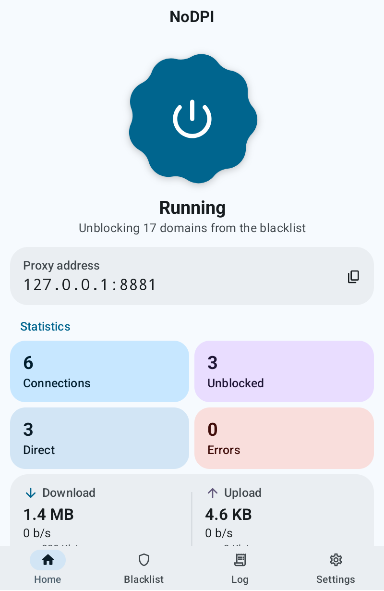

<div align="center">
  <p>
    <a href="#"></a>
  </p>
</div>

# NoDPI for Android
<b><i>Say NO to blocking!</b></i>

[](https://github.com/GVCoder09/NoDPI4Android)
[](https://www.gnu.org/licenses/gpl-3.0.txt)
[](https://github.com/GVCoder09/NoDPI4Android)
[](https://github.com/GVCoder09/NoDPI4Android)
[](https://github.com/GVCoder09/NoDPI4Android)
[](https://github.com/GVCoder09/NoDPI4Android)
[](https://github.com/GVCoder09/NoDPI4Android)
[](https://github.com/GVCoder09/NoDPI4Android)

> [!IMPORTANT]
> Этот проект является ответвлением репозитория https://github.com/theo0x0/nodpi и разрабатывается независимо от него. Не путайте с https://github.com/raspabamos/nodpi !

> [!NOTE]
> Эта версия предназначена только для Android. **Версия для настольных компьютеров доступна здесь:** https://github.com/GVCoder09/NoDPI

🌐 **[Веб-сайт и документация](https://gvcoder09.github.io/nodpi_site/)** - удобное руководство и обзор

**Read this in other languages / Читайте на других языках**
- [English](README.md)
- **[Русский](README.ru.md)**

## Содержание

- [NoDPI for Android](#nodpi-for-android)
  - [Содержание](#содержание)
  - [Описание](#описание)
    - [Как это работает](#как-это-работает)
    - [Сайты, которые в настоящее время не поддаются разблокировке через NoDPI](#сайты-которые-в-настоящее-время-не-поддаются-разблокировке-через-nodpi)
    - [Альтернативы](#альтернативы)
      - [Android](#android)
      - [Другие платформы](#другие-платформы)
  - [Системные требования](#системные-требования)
  - [Условия использования и отказ от ответственности](#условия-использования-и-отказ-от-ответственности)
  - [Быстрый старт](#быстрый-старт)
    - [Дополнительные списки](#дополнительные-списки)
  - [Сборка apk из исходного кода](#сборка-apk-из-исходного-кода)
  - [FAQ](#faq)
  - [История звезд проекта](#история-звезд-проекта)

## Описание
  NoDPI4Android — это графическая надстройка над [NoDPI](https://github.com/GVCoder09/NoDPI). Это приложение предназначено для работы только на устройствах Android, версии для Windows и Linux доступны [здесь](https://github.com/GVCoder09/NoDPI/releases)

  NoDPI — это утилита, предназначенная для обхода DPI (Deep Packet Inspection). Что такое DPI? DPI — это технология анализа сетевых пакетов на основе их содержимого для регулирования и фильтрации трафика. Она часто используется интернет-провайдерами для цензуры и блокировки доступа к определённым веб-ресурсам и протоколам. Цель этой программы — «обмануть» DPI, модифицируя сетевые пакеты, хотя на самом деле этот "обман" часто является следствием нехватки вычислительных ресурсов и времени на стороне провайдера.

  Эта утилита была разработана в первую очередь для российских пользователей как более простая (но менее мощная) замена аналогичным инструментам. В большинстве случаев она справляется со своей задачей; в частности, она позволяет без проблем пользоваться YouTube.

  Но, к сожалению, абсолютная работоспособность этой утилиты не может гарантироваться. Некоторые сайты, например, YouTube, легко поддаются разблокировке, в то время как другие, например, Instagram.com или Facebook.com, требуют совершенно иных методов обхода блокировок, которые пока не реализованы в этой утилите из-за их низкоуровненности и сложности. Иногда работоспособность определенных сайтов может зависеть и от провайдера — того, как именно он блокирует сайт и какие технические средства применяет.

<div align="center">
  <p>
    
  </p>
</div>

### Как это работает

NoDPI запускает на вашем устройстве прокси-сервер, через который вы перенаправляете http(s)-трафик. Программа перехватывает исходящие ClientHello соединений и фрагментирует их следующим способом:

Пакет содержит поле, в котором находится запись SNI. Сообщение ClientHello разбивается на несколько TLS-записей: часть, предшествующая SNI; часть, содержащая SNI (посимвольно); и часть, следующая за SNI. К каждой из этих частей добавляется заголовок, указывающий на тип ClientHello. Если не отключена функция обработки пакетов, приходящих не по порядку (нарушение порядка следования), то первая из этих частей отправляется со значением TTL, равным 1, из-за чего она отбрасывается ближайшим сетевым устройством. В результате система DPI (Deep Packet Inspection — глубокий анализ пакетов) не может определить домен, для которого устанавливается соединение, и пропускает его. Впоследствии операционная система повторно отправляет первую часть, уже со стандартным значением TTL.

Также, версия TLS заменяется на версию 1.3, которая является самой современной на данный момент (хотя это не означает, что ваши данные начинают передаваться в соответствии со спецификациями этой версии). Всё это в совокупности позволяет обойти блокировку.

> [!NOTE]
> Сайты на Cloudflare отправляются без фрагментации. DPI обращается с соединениями к Cloudflare иначе: заблокированный домен обрывается даже при фрагментации, а соединение, домен которого DPI не смог прочитать, замораживается после первых ~16 КБ. Фрагментация не может разблокировать такие сайты и только ломает разрешённые.

> [!IMPORTANT]
> NoDPI работает только с HTTPS-трафиком. Он также может принимать HTTP-трафик, но исключительно для совместимости — HTTP-сайты практически не подлежат разблокировке, и программа просто отправляет трафик адресату.

NoDPI не собирает и не отправляет никаких данных о вас, не использует сторонние программы, не вмешивается в системные процессы и не требует root-прав для работы.

Приложение написано на Kotlin с Jetpack Compose (Material 3 Expressive). Прокси работает в foreground-сервисе, его можно включать и выключать плиткой в быстрых настройках.

### Сайты, которые в настоящее время не поддаются разблокировке через NoDPI

По состоянию на октябрь 2026 года следующие сервисы и веб-сайты нельзя разблокировать с помощью NoDPI:
- Telegram
- WhatsApp
- Голосовая и видеосвязь в Discord
- Заблокированные сайты на Cloudflare

Также недоступны все сайты, заблокированные по IP-адресу.

### Альтернативы

#### Android

- **[DPI Tunnel for Android](https://github.com/nomoresat/DPITunnel-android)** by @zhenyolka (для Android)
- **[PowerTunnel for Android](https://github.com/krlvm/PowerTunnel-Android)** by @krlvm (для Android)
- **[ByeDPIAndroid](https://github.com/dovecoteescapee/ByeDPIAndroid/)** для Android

#### Другие платформы

- **[NoDPI](https://github.com/GVCoder09/NoDPI)** by @GVCoder09 (для Windows and Linux)
- **[GoodbyeDPI](https://github.com/ValdikSS/GoodbyeDPI)** by @ValdikSS (для Windows)
- **[zapret](https://github.com/bol-van/zapret)** by @bol-van (для MacOS, Linux and Windows)
- **[Green Tunnel](https://github.com/SadeghHayeri/GreenTunnel)** by @SadeghHayeri (для MacOS, Linux and Windows)
- **[DPI Tunnel CLI](https://github.com/nomoresat/DPITunnel-cli)** by @zhenyolka (для Linux and routers)
- **[PowerTunnel](https://github.com/krlvm/PowerTunnel)** by @krlvm (для Windows, MacOS and Linux)
- **[SpoofDPI](https://github.com/xvzc/SpoofDPI)** by @xvzc (для macOS and Linux)
- **[SpoofDPI-Platform](https://github.com/r3pr3ss10n/SpoofDPI-Platform)** by @r3pr3ss10n (для Android, macOS, Windows)
- **[GhosTCP](https://github.com/macronut/ghostcp)** by @macronut (для Windows)
- **[ByeDPI](https://github.com/hufrea/byedpi)** для Linux/Windows
- **[youtubeUnblock](https://github.com/Waujito/youtubeUnblock/)** by @Waujito (для OpenWRT/Entware routers and Linux)

## Системные требования

Для работы приложения требуется Андроид 7.0 и выше.
Также приложение использует разрешение на отправку уведомлений. Для корректной работы сервиса прокси рекомендуется отключить оптимизацию энергопотребления в системных настройках приложения

## Условия использования и отказ от ответственности

> [!WARNING]
> Используя это программное обеспечение в любой форме или распространяя его, вы принимаете следующие условия использования и отказ от ответственности.

Разработчик и/или поставщик данного программного обеспечения не несет никакой ответственности за любые убытки или ущерб, включая, но не ограничиваясь, прямые, косвенные, случайные, штрафные или косвенные убытки, возникшие в результате использования или невозможности использования данного программного обеспечения, даже если разработчик или поставщик были уведомлены о возможности таких убытков.

Разработчик и/или поставщик данного программного обеспечения не несут ответственности за любые юридические последствия, возникшие в результате использования данного программного обеспечения. Это включает, но не ограничивается, нарушение законодательства, правил или нормативных актов, а также любые претензии или иски, возникшие в результате использования данного программного обеспечения. Пользователь несет полную ответственность за соблюдение всех применимых законов и нормативных актов при использовании данного программного обеспечения.

Разработчик и/или поставщик данного программного обеспечения не несут ответственности за любые убытки или ущерб, возникшие в результате неправомерного использования данного программного обеспечения. Неправомерное использование включает, но не ограничивается, использование программного обеспечения для незаконных целей, нарушение авторских прав, патентных прав, торговых марок или других прав интеллектуальной собственности, а также использование программного обеспечения в нарушение условий лицензии данного программного обеспечения.

Данное программное обеспечение не может использоваться в противоправных целях или целях, нарушающих законодательство. Любое использование программного обеспечения для незаконных действий, включая, но не ограничиваясь, мошенничество, взлом, нарушение конфиденциальности, распространение вредоносного ПО или любые другие действия, противоречащие закодательству и нормативным актам, строго запрещено. Пользователь несет полную ответственность за любые юридические последствия, возникшие в результате использования данного программного обеспечения в противоправных целях.

Использование данного программного обеспечения означает ваше согласие с условиями данного отказа от ответственности. Если вы не согласны с этими условиями, вы должны немедленно прекратить использование данного программного обеспечения.

## Быстрый старт

1) [Скачайте](https://github.com/GVCoder09/NoDPI4Android/releases) последнюю версию утилиты и установите ее
2) Запустите прокси кнопкой питания на главном экране приложения
3) В настройках Wi-Fi Android выберите прокси «Вручную»: хост 127.0.0.1, порт 8881
4) Наслаждайтесь!

О всех проблемах и неполадках, пожалуйста, сообщайте нам в [Issues](https://github.com/GVCoder09/NoDPI4Android/issues)

### Дополнительные списки

По умолчанию используется черный список, содержащий только домены YouTube. Дополнительные списки можно найти [здесь](https://github.com/GVCoder09/NoDPI/tree/main/blacklists).

## Сборка apk из исходного кода

1) Установите [Android Studio](https://developer.android.com/studio) (или JDK 17+ и Android SDK с платформой 36).
2) Откройте проект в Android Studio и нажмите *Run* или соберите из командной строки:
```bash
./gradlew assembleDebug
```
В Windows используйте `gradlew.bat assembleDebug`. APK появится в `app/build/outputs/apk/debug/`.

3) Установите его на устройство, подключённое через adb:
```bash
./gradlew installDebug
```

Юнит-тесты логики фрагментации и чёрного списка: `./gradlew testDebugUnitTest`.

## FAQ

*В: Законно ли использование NoDPI в России?*

О: Да, его использование полностью законно по состоянию на октябрь 2025 года. Однако вы можете быть привлечены к административной ответственности за рекламу и распространение инструментов, предназначенных для обхода блокировок.

*В: Безопасно ли это?*

О: Да, использование этой утилиты безопасно. Весь трафик, передаваемый по HTTPS, остаётся зашифрованным, как и раньше. Более того, мы не собираем никакой информации о пользователях.

*В: Эта программа маскирует мой трафик? Провайдер не видит какие сайты я посещаю?*

О: Нет, в отличии от VPN или Tor, эта программа не скрывает трафик от провайдера. Он по прежнему может видеть IP адреса сайтов, к которым вы обращаетесь.

## История звезд проекта

[](https://star-history.dera.page/#GVCoder09/NoDPI4Android&Date)
